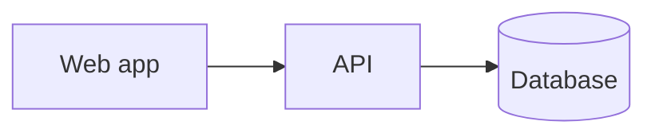

# Report template

Fill each section in order and replace `<...>` placeholders.

````markdown
# Spelunk: <subject>

Scope: <whole repository | path | feature> · Commit: `<sha>` · Date: <YYYY-MM-DD> · Depth: <quick | standard | deep>
<When replacing an earlier report: Previous report commit: `<sha>`>

## What this is

<2 or 3 plain-language sentences: what it does, for whom, and why it exists.>

## Parts

| Part | Path | Kind | What it is for | Activity |
|---|---|---|---|---|
| <name> | `<path>` | <app/service/library/tool/config> | <one plain-language line> | <N> commits in 6 months · last change <YYYY-MM-DD> |

### <Part name>

<2 or 3 plain-language sentences on its role.>

- Entry points: `<path:line>`, <trigger>
- Depends on: <internal parts>
- Key external dependencies: <names>

## How the parts relate



<One sentence per non-obvious edge, with its import site as `path:line`.>

## Key external dependencies

| Dependency | What it does here | Used by |
|---|---|---|
| <name> | <role in this subject> | <parts> |

## Getting started

### Run it

```bash
<install, dev, and test commands, copied exactly>
```

### Tour

<The traced flow, one numbered step per hop.>

1. `<path:line>`: <what happens here>

### Where to change things

| To change | Start at |
|---|---|
| <common task> | `<path>` |

## Caveats

1. **<short title>**: you might expect <usual behavior>; here <actual behavior>. `<path:line>` (<confidence>)

## Coverage

- Explored: <parts and flows>
- Skipped: <parts or paths, and why>
- Inferred claims: <list, or "none">
````
